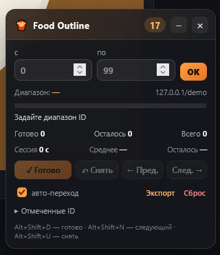

# Food Outline Progress — Firefox extension

Расширение для учёта прогресса обводки еды в CVAT и похожих задачах.



## Что умеет

- Плавающая панель прямо на странице задачи.
- Текущий ID карточки: берётся из `frame`/`id`/`image` в URL, из input с
  `frame` или из `data-frame-number`.
- Диапазон ID «с N по M»: `50–100`.
- Прогресс: выполнено / всего / осталось / процент.
- Кнопки «Готово», «Снять», «Следующий», «Предыдущий».
- Авто-переход к следующей неотмеченной карточке.
- Статистика: время сессии, среднее на карточку, ETA.
- Список отмеченных ID.
- Экспорт прогресса в JSON.
- Горячие клавиши:
  - `Alt+Shift+D` — отметить текущую;
  - `Alt+Shift+U` — снять отметку;
  - `Alt+Shift+N` — следующая неотмеченная;
  - `Alt+Shift+P` — открыть/закрыть панель.
- Настройки: авто-открытие, авто-переход, кнопка-лончер.
- Импорт/экспорт/очистка всего прогресса.
- Progress хранится локально в `browser.storage.local`, отдельно для каждого
  задачи/job (scope = origin + path + hash path).

## Установка в Firefox

1. Откройте `about:debugging#/runtime/this-firefox`.
2. «Load Temporary Add-on…».
3. Выберите `manifest.json` из этой папки.
4. Откройте страницу CVAT или демо.

После перезапуска Firefox временное расширение нужно загрузить снова.

## Демо

```powershell
cd "D:\Projects\Automatization_images_firefox"
python -m http.server 8000
```

Откройте:

```text
http://localhost:8000/demo/?frame=10
```

В демо можно менять кадр кнопками, а расширение будет показывать панель,
считать прогресс и переходить по ID.

Или запустить Firefox сразу с расширением (нужен `web-ext`):

```powershell
npm start
```

## Как пользоваться

1. Откройте задачу/job в CVAT.
2. В панели задайте диапазон, например `50` и `100`.
3. Нажмите `OK`.
4. Отмечайте карточки кнопкой «Готово» или `Alt+Shift+D`.
5. «Следующий» / `Alt+Shift+N` переходит к первой неотмеченной.
6. Экспорт — в настройках расширения или кнопкой «Экспорт» в панели.

Если ID определяется неверно, проверьте URL: расширение ищет `frame=` в query
и hash, затем input с `frame` в атрибутах. Для нестандартного сайта можно
добавить свой домен в `content_scripts.matches` в `manifest.json`.

## Если панель не открывается

Popup теперь умеет сам внедрять content script в открытую вкладку. Если всё
равно пишет «Не удалось открыть панель»:

1. Убедитесь, что расширение загружено в **том же профиле Firefox**, где открыт
   CVAT.
2. Нажмите `F5` на странице CVAT.
3. Если popup пишет **`Missing host permission for the tab`**:
   - откройте popup именно на вкладке CVAT, а не на `about:debugging`;
   - в popup должна быть кнопка **«Разрешить доступ к сайтам»** — нажмите её и
     разрешите доступ;
   - либо `about:addons` → **Food Outline Progress** → «Разрешения» → доступ к
     сайтам.
4. Откройте `about:debugging#/runtime/this-firefox` и проверьте, что версия
   расширения **0.1.3**. Если нет — удалите старую и загрузите `manifest.json`
   заново.
5. Browser Console (`Ctrl+Shift+J`) — там будут строки `Food Outline ...` с
   точной причиной.

`Missing host permission for the tab` почти всегда значит, что popup открыт на
служебной вкладке (`about:...`) или Firefox не дал доступ к сайту. На вкладке
CVAT нажмите иконку расширения ещё раз.

## Где хранится прогресс

`browser.storage.local`, ключи `fo:state:<scope>`. Настройки — `fo:settings`.
Экспорт из настроек сохраняет все диапазоны в один JSON.

## Разработка

```powershell
npm test          # unit-тесты pure-логики
npm run lint      # web-ext lint
npm run build     # собрать XPI в dist/
```

Структура:

```text
manifest.json
src/lib.js        # чистые функции: парсинг ID, диапазон, статистика
src/content.js    # HUD, storage, навигация
src/hud.css       # стили панели
src/popup.*       # popup
src/options.*     # настройки и экспорт/импорт
demo/             # локальная демо-задача
tests/lib.test.js # Node tests
```

## Ограничения

- Расширение не размечает еду само — это трекер прогресса.
- Авто-переход зависит от сайта: сначала пробует input/кнопку кадра, затем
  меняет URL и перезагружает страницу.
- На нестандартных сайтах нужно добавить домен в `manifest.json`.
- Автоматическое определение «карточка размечена» не делается: отметка ставится
  вручную, чтобы не путать предразметку с проверенной.

## Git

Это отдельный репозиторий:

```text
D:\Projects\Automatization_images_firefox
```
